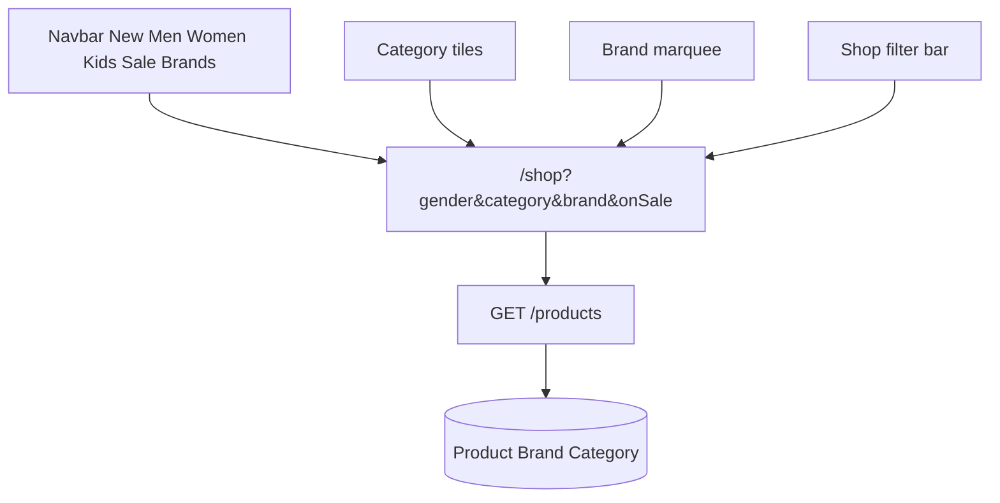

# Plan: Fully functional categories, filters, and brands

## Overview

Make categories, gender/sale filters, and brands reliably list **all matching products**. Keep the existing single listing API (`GET /products`) and harden matching, seed coverage, and the shop UI filter bar.

## Current gaps

| Area | Problem |
|---|---|
| Home catalog | `GET /catalog/home` only loads **4** products — local gender chips cannot show full sets |
| Category filter | Name match is case-sensitive on SQLite (`Running` vs `running`) |
| Brands | Several brands have **0 products** (New Balance, Converse, Vans, etc.) → empty shop |
| Brand marquee | Uppercase names are display-only; **not linked** to `/shop?brand=…` |
| Shop page | No in-page filter controls; title shows raw slug (`running`) not `Running` |
| Combined filters | Backend supports AND, but UI cannot pick category + brand + gender together |

## Approach

Shop page is the source of truth for filtered listings. Navbar / tiles / brands only set URL search params. Backend returns every matching published product (default `limit` raised to 100).

## Backend ([`products.service.ts`](sole-elite-forge-main/backend/src/products/products.service.ts))

1. **Category match** — resolve by `id` (lowercased) **or** case-insensitive `name` (load categories and compare `toLowerCase()`, same pattern as brand).
2. **Default limit** — use `100` when `limit` omitted so “all matching” is not silently capped at a low number; keep `ProductQueryDto` max at 100.
3. **Seed** ([`prisma/seed.ts`](sole-elite-forge-main/backend/prisma/seed.ts)) — add at least one published product for each empty brand (New Balance, Converse, Vans, Skechers if present) with valid image URLs, gender, and a category so brand/category grids are never empty.

No new Nest controllers. Still only `GET /products`, `GET /brands`, `GET /categories`.

## Frontend shop ([`shop.tsx`](sole-elite-forge-main/src/routes/shop.tsx))

1. **Filter bar** above the grid with:
   - Gender: All / Men / Women / Kids  
   - Category: All + options from `GET /categories`  
   - Brand: All + options from `GET /brands`  
   - Sale toggle  
   - Clear filters  
   Updates TanStack Router `search` params → same `useShopProducts` refetch.
2. **Title** — resolve category id to display name; capitalize brand; keep Sale / New / gender titles.
3. **Empty state** — keep “No products match this filter” when API returns `[]`.
4. **Hooks** — add `useCategories()` mirroring `useBrands()` in [`use-catalog.ts`](sole-elite-forge-main/src/hooks/use-catalog.ts); expose `api.getCategories()`.

## Homepage ([`index.tsx`](sole-elite-forge-main/src/routes/index.tsx))

1. **Brand marquee** — link each brand to `/shop?brand={ProperCase}` (map from `GET /brands` / catalog brands, not dead `#`).
2. Keep trending strip as a **preview** (`limit: 4` on home API is fine). Gender chips already navigate to `/shop?gender=…` for full results — leave that behavior.
3. Category tiles already go to `/shop?category={id}` — leave wired.

## Verify (manual)

- `/shop?category=running` → all Running products (not truncated incorrectly)
- `/shop?brand=ASICS` and `Asics` → Studio Flow (+ any new Asics)
- `/shop?gender=men` → men + unisex
- `/shop?onSale=true` → only `compareAtPrice > price`
- Filter bar: set Category=Training + Gender=Women → Studio Flow
- Brands page → each brand opens shop with products after seed
- Marquee brand click → shop for that brand

## Out of scope

- Pagination UI / infinite scroll  
- Price range facets  
- Admin product CRUD  
- Changing home trending to load entire catalog
